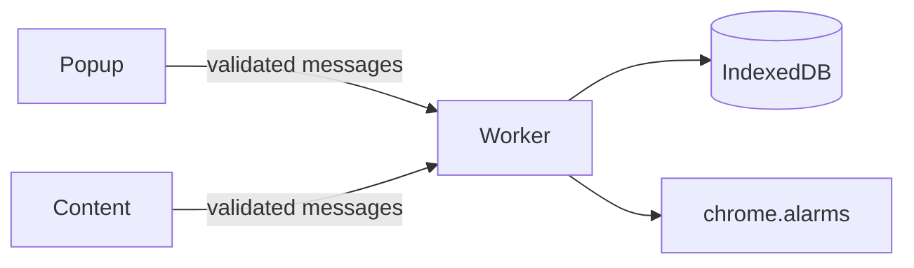

# PriceRadar

PriceRadar is a local-first Manifest V3 Chrome extension for tracking product prices. Phase 0 establishes the Vite/CRXJS build, typed message boundary, Dexie schema, service-worker lifecycle, and a minimal accessible popup.

## Architecture



The service worker is treated as ephemeral: durable state lives in IndexedDB and scheduling is recreated on install/startup. CRXJS is selected because it integrates Manifest V3 entry points directly with Vite and keeps the build configuration small.

## Development

```powershell
npm install
npm run build
```

Load the generated `dist` directory at `chrome://extensions` with Developer mode enabled.

## Project phases

Extraction, background checking, alerts, dashboard UI, adapters, intelligence, portability, hardening, and optional sync are intentionally scheduled after this foundation.
